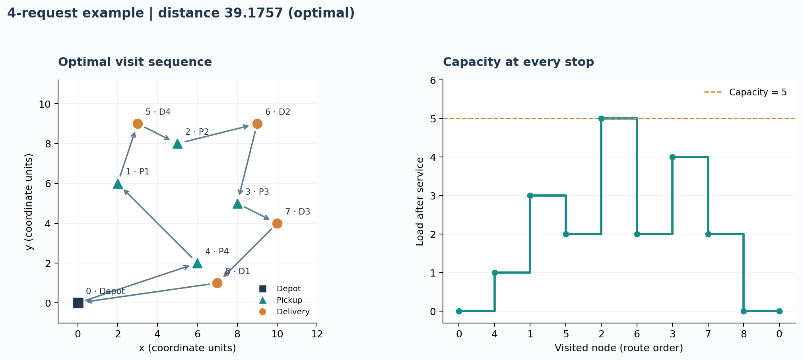
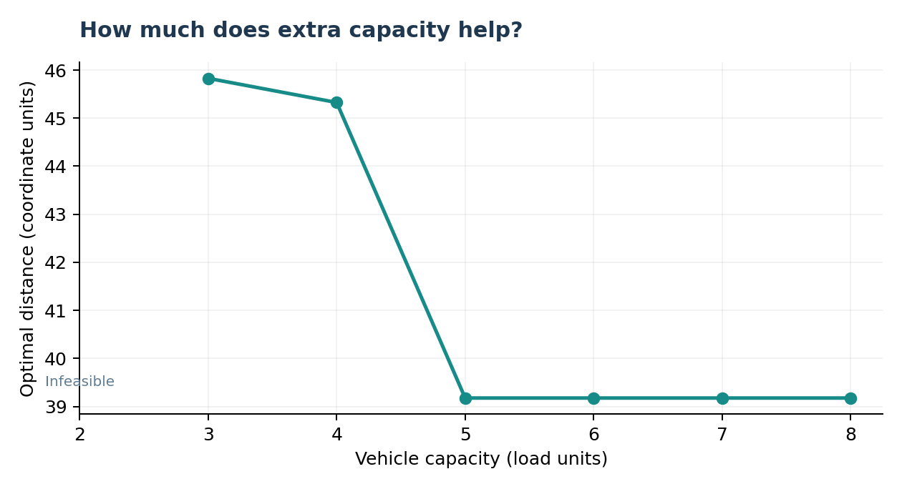

# Pickup-and-delivery route optimization

**How should one vehicle sequence pickups and deliveries while respecting capacity and customer precedence?**

An auditable mixed-integer linear programming project by **Jihad Boussata**, developed from my University of Granada MACE optimization coursework. It includes a reusable Python implementation, a solver-independent route checker, a transparent heuristic baseline and an independent exhaustive reference for the small example.



## Verified result

The included synthetic example has **one vehicle, four requests, eight customer stops and capacity 5**. Distances are Euclidean coordinate units, not kilometres or measured operational costs.

| Method | Distance | Evidence |
| --- | ---: | --- |
| Nearest feasible next stop | 43.1718 | Feasible deterministic heuristic |
| MILP / HiGHS | **39.1757** | Optimal; reported relative MIP gap 0 |
| MILP / Gurobi | **39.1757** | Same formulation; independently checked locally |
| Exhaustive reference | **39.1757** | All 40,320 customer permutations; 864 feasible |

The optimized route is **9.26% shorter than the greedy route on this example**:

```text
0 -> 4 -> 1 -> 5 -> 2 -> 6 -> 3 -> 7 -> 8 -> 0
```

Loads after service are `0, 1, 3, 2, 5, 2, 4, 2, 0, 0`. Every pickup precedes its own delivery, and the vehicle returns empty. This is a comparison on one small synthetic instance, not a claim about production fleet savings or large-instance performance.

## Run it

Python 3.12 was used for the committed results. From the repository root:

```bash
python -m venv .venv
# Linux / macOS:
source .venv/bin/activate
# Windows PowerShell alternative: .venv\Scripts\Activate.ps1
python -m pip install -r requirements.txt
python -m pip install --no-deps -e .
python -m unittest discover -s tests -v
python -m pickup_delivery --verify --sensitivity 2 3 4 5 6 7 8
```

The default solver is **HiGHS through SciPy**: no proprietary solver or license is required. Outputs go to `results-local/`, which is ignored by Git; the reviewed reference outputs are in [results/](results/). The CLI must be run from this root unless `--instance` specifies another JSON path.

For the optional Gurobi backend:

```bash
python -m pip install '.[gurobi]'
python -m pickup_delivery --solver gurobi --verify --output results-local/gurobi
```

Gurobi is separately licensed. The small example fits the size-limited development/evaluation license distributed with `gurobipy`; commercial use requires an appropriate license. No license file or credential is included. Both backends solve the same matrix formulation. The optional backend test runs when `gurobipy` is installed; standard CI tests the license-free path.

## Model and checks

- Binary arc variables choose one incoming and one outgoing edge per node.
- Continuous visit-order variables and **Miller-Tucker-Zemlin (MTZ)** constraints eliminate disconnected subtours.
- Explicit pickup-before-delivery inequalities preserve request identity; aggregate load alone cannot guarantee precedence.
- Post-service load variables enforce capacity and exact load updates on selected arcs, including the return to the depot.
- Separate lower/upper load big-M constants are derived from bounds, replacing the single conservative constant in the original notebook.
- Route reconstruction rejects premature depot returns and disconnected cycles. An independent checker recomputes precedence, loads and objective from the returned sequence.
- Solver status, bound and gap are exported. A time-limited incumbent is labelled `feasible_limit`, never `optimal`; no incumbent is reported as `no_solution`.

For the supplied instance the revised formulation has **89 variables (72 binary) and 222 constraints**, excluding variable bounds. See the [mathematical formulation](docs/MODEL.md) and [changes from the original submission](docs/CHANGES.md).

## Capacity sensitivity



Capacity 2 is infeasible because one request has quantity 3. The optimal distance decreases from 45.8286 at capacity 3, to 45.3252 at 4, and 39.1757 at 5. Capacities 6-8 do not improve the optimum in this example. Each tested capacity was checked by exhaustive enumeration as well as MILP. See [the CSV](results/capacity_sensitivity.csv).

## Navigate the project

| Location | Purpose |
| --- | --- |
| [data/four_requests.json](data/four_requests.json) | Explicit coordinates, request pairs, quantities and capacity |
| [pickup_delivery/](pickup_delivery/) | Input validation, sparse MILP, solvers, baselines, CLI and figures |
| [notebooks/walkthrough.ipynb](notebooks/walkthrough.ipynb) | Executed walkthrough of the actual model and verification |
| [tests/test_routing.py](tests/test_routing.py) | Optimization checks and intentionally invalid routes/data |
| [results/](results/) | Solution, route CSV, comparison, figures and environment |
| [docs/PROVENANCE.md](docs/PROVENANCE.md) | Coursework origin, source hashes and licensing scope |

## Scope

This is a **single-vehicle pickup-and-delivery problem without time windows**. Each non-depot node belongs to exactly one request. There are no split deliveries, multiple vehicles, service times, road-network travel times, stochastic demand or real customer records. The MTZ formulation is useful for explaining and validating small cases; large production instances need different formulations or routing heuristics. Exhaustive verification is deliberately limited to four requests (eight customer stops). The current code does not benchmark scalability.

## References and license

- [SciPy `milp` reference](https://docs.scipy.org/doc/scipy/reference/generated/scipy.optimize.milp.html) (HiGHS backend).
- [Gurobi Python reference](https://docs.gurobi.com/projects/optimizer/en/current/reference/python/overview.html).
- [Gurobi size-limited license explanation](https://support.gurobi.com/hc/en-us/articles/29682074018833-What-does-Restricted-license-for-non-production-use-only-mean).

New project code and documentation are MIT licensed; Gurobi and other dependencies retain their own licenses. The original assignment statement and submitted report are not redistributed. The small numerical example is attributed to the coursework in [PROVENANCE.md](docs/PROVENANCE.md).
